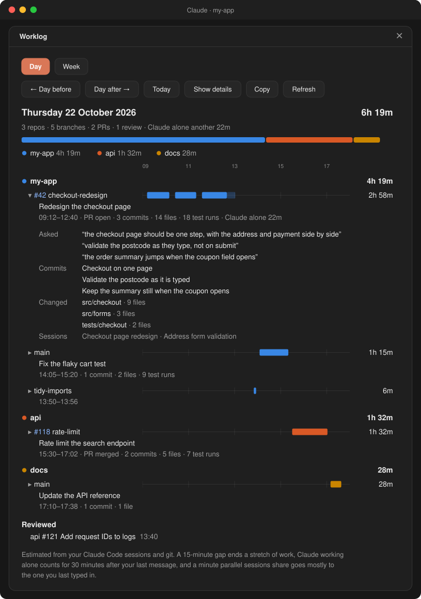
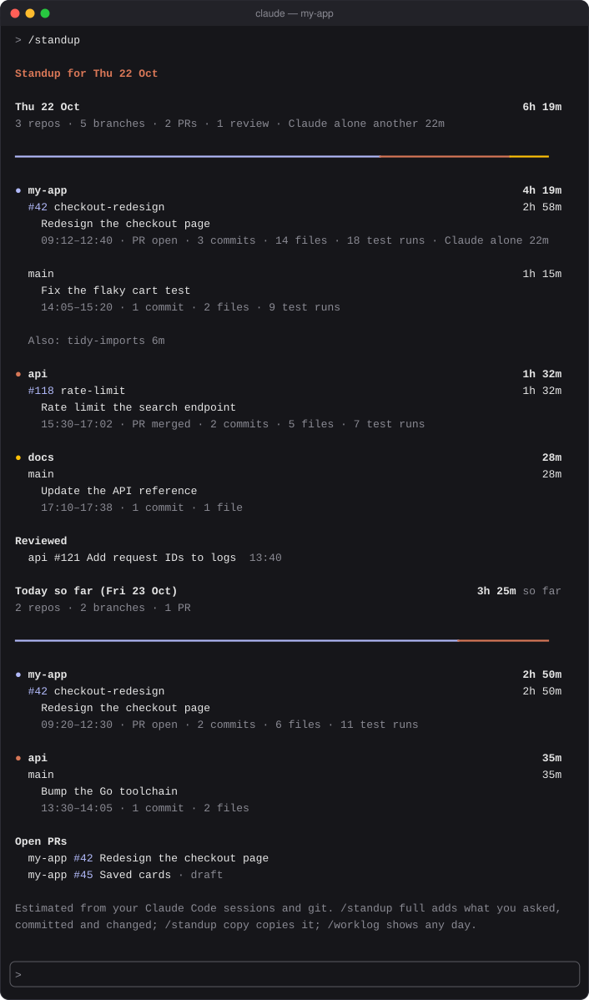
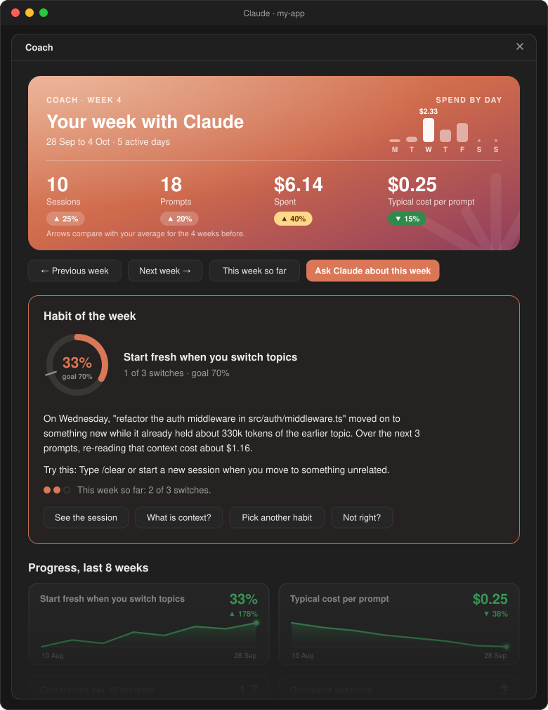
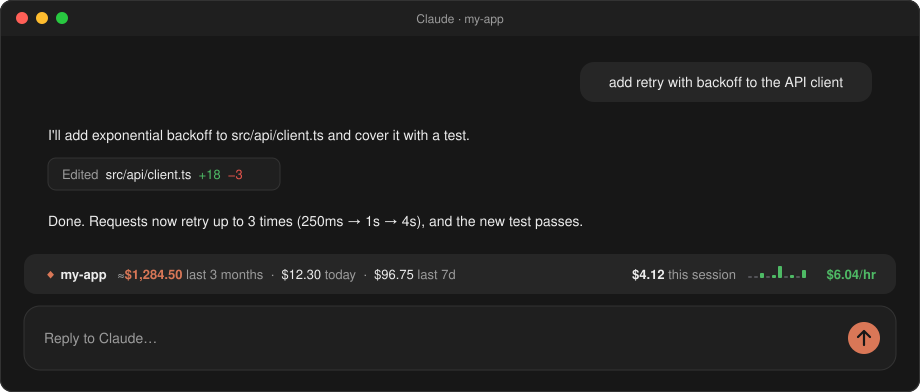

<div align="center">

# qol-mods

**Quality-of-life mods for [Claude Code](https://claude.com/claude-code).**

Add-ons that make Claude Code better to use.
Each one adds something the built-in experience doesn't give you.

[](#install)
[](LICENSE)
[](https://qolmods.dev/)

</div>

## Mods

| Mod | What it does | |
| --- | --- | --- |
| **[worklog](plugins/worklog)** <sup>new</sup> | What you did, day by day, across every repo, by PR and branch with the time spent: `/standup` for the meeting, `/worklog` for any day or a week's timesheet | [Website](https://qolmods.dev/worklog/) |
| **[coach](plugins/coach)** | A weekly coach built from your own sessions: one habit at a time, tips at your level, CLAUDE.md lines and skills worth making | [Website](https://qolmods.dev/coach/) |
| **[repo-spend](plugins/repo-spend)** | A live bar above the prompt with what the repo has cost you: running total, today, the last 7 days, and this session's burn rate | [Website](https://qolmods.dev/repo-spend/) |

More are on the way. Each mod's README has the full details.

### [worklog](plugins/worklog)

What did I do yesterday? worklog reads the sessions you've already had and your repos' git, and lays out your work day by day: every repo, grouped by PR and branch, with the time spent, what each was, and its commits, files and test runs. `/standup` covers the last work day (Monday covers Friday and the weekend), `/worklog` shows any day with a timeline of when you worked, and `/worklog week` makes the week's timesheet, rounded to 15 minutes, to copy or save as CSV.


<p><sub><code>/worklog</code> in the Claude desktop app</sub></p>


<p><sub><code>/standup</code> in the terminal</sub></p>

```
/plugin install worklog --marketplace aseem-upadhyay/qol-mods
```

### [coach](plugins/coach)

How well are you using Claude Code, and what's the one thing to get better at next? coach reads the sessions you've already had and picks the habit that would help you most, shows you the session it came from, and tracks how you're doing week by week. It also suggests CLAUDE.md lines for what Claude keeps rediscovering, and skills for prompts you keep typing.


<p><sub>The weekly report in the Claude desktop app</sub></p>

```
/plugin install coach --marketplace aseem-upadhyay/qol-mods
```

### [repo-spend](plugins/repo-spend)

How much have you burned on this repo, and how much value are you getting from your plan? A live bar above the prompt shows the repo's total over the time your logs cover ("last 3 months"), today, the last 7 days, and this session's cost and burn rate. On an API key that's the credits you've spent; on Pro or Max, what your usage would have cost at API prices.


<p><sub>The bar in the Claude desktop app</sub></p>

```
/plugin install repo-spend --marketplace aseem-upadhyay/qol-mods
```

## Install

Every mod installs the same way. Type this at the prompt of a Claude Code terminal session, replacing `<mod>` with the mod's name:

```
/plugin install <mod> --marketplace aseem-upadhyay/qol-mods
```

Answer `y` to add the marketplace (only the first time), then pick the **user** scope so the mod loads in every session. Installing from a terminal also makes the mod load in the desktop app's Code tab.

To pick up new versions:

```bash
claude plugin marketplace update qol-mods && claude plugin update <mod>@qol-mods
```

Then type `/reload-plugins` in any session that was already open.

## Layout

```
.claude-plugin/marketplace.json   the catalogue: every mod in this repo
plugins/<mod>/                    one self-contained plugin per mod, with its own README
shared/                           code more than one mod uses; each keeps a copy (scripts/sync-shared.py)
scripts/                          helpers for maintaining the mods, such as drawing README images
docs/                             the website, qolmods.dev: a home page with a card per mod, and docs/<mod>/ for each mod's page
```

## Adding or changing a mod

1. Put the plugin in `plugins/<mod>/`, with a `.claude-plugin/plugin.json` and a README, and list it in `.claude-plugin/marketplace.json`.
2. When it launches, add it to the table and a section under [Mods](#mods), give it a card in `docs/index.html` and a page at `docs/<mod>/index.html` (copy an existing one), put its images in `docs/assets/<mod>/`, and list the page in `docs/sitemap.xml`.
3. Raise `version` in its `plugin.json` with every change. Installed copies are cached by version, so a change under the same version never reaches anyone, including your own desktop sessions.
4. Check it, then commit:

```bash
claude plugin validate . && claude plugin validate plugins/<mod> && claude plugin test plugins/<mod>
```

## License

[MIT](LICENSE)
