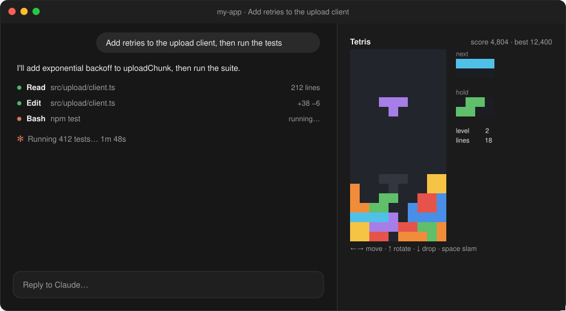
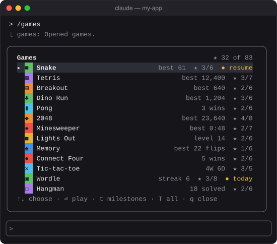

<div align="center">

# games

**A quick game while Claude works.**

Thirteen games you already know in a side pane, with milestones to chase and your progress saved between sessions.

[](#install)
[](../../LICENSE)
[](https://qolmods.dev/games/)

</div>


<p><sub>In the Claude desktop app, while Claude works</sub></p>


<p><sub>In the terminal (<code>claude</code>): the list of games, with your bests and milestones</sub></p>

## Features

- 🎮 **Thirteen games you already know.** Snake, Tetris, Breakout, Dino Run and Pong; 2048, Minesweeper, Lights Out and Memory; Connect Four and Tic-tac-toe against a bot; Wordle and Hangman. Played with the arrow keys or the mouse, with one line of score above the board and one line of controls below it, and nothing else.
- ★ **Milestones.** 83 small goals across the games, from "eat once" to "beat Connect Four on Hard three times in a row". A toast says when you get one, and each shows how close you are: "12 of 25".
- 💾 **Progress that stays.** Bests, streaks, milestones and the game you left halfway are kept between sessions. Arcade games come back paused, right where you left them.
- 📅 **A daily Wordle.** One puzzle a day, the same all day, with a daily streak; practice games as many as you like.
- ⏸️ **Out of the way.** Typing in the prompt, or Claude starting or finishing a turn, pauses an arcade game. A toast says when Claude is done. Turn on **Suggest a game during long turns** for one line above the prompt when Claude has been working a minute.
- 🖥️ **At home on both.** In the desktop app the pane sits beside the conversation; in the terminal it fits the strip above the prompt, with smaller tiles where it has to.
- 🔀 **Parallel sessions are fine.** Two sessions playing at once add to each other's stats instead of overwriting them.
- 🏁 **See how it ended.** A finished board stays on screen, with the result on the line below it.
- 🔒 **All local.** Nothing is sent anywhere; no game calls a model.


<p><sub>Six of the thirteen, as the pane draws them</sub></p>

## Install

Type this at the prompt of a Claude Code terminal session:

```
/plugin install games --marketplace aseem-upadhyay/qol-mods
```

Answer `y` to add the marketplace and pick the **user** scope.

## Use

| Command | What it does |
| --- | --- |
| `/games` | Opens the pane on the list of games |
| `/games snake`, `/games mines`, `/games c4`, `/games ttt`, ... | Opens that game, resuming one you left. Names and short forms both work: `lights`, `memory`, `connect4`, `tictactoe`, `wordle`, `hangman` |
| `/games milestones` | Every game's milestones |
| `/games close` | Closes the pane; a game in progress is saved first |
| `/games reset <game>`, `/games reset all` | Resets stats and saved games, and milestones too if you choose |

`/games` works while Claude is in the middle of a turn.

### Keys

| Key | In every game |
| --- | --- |
| **p** | Pause (Snake, Tetris, Breakout, Dino Run, Pong and Minesweeper) |
| **r** | New game; asks first if one is under way |
| **h** | Back to the list |
| **t** | This game's milestones |
| **q** | Close the pane |
| **Esc** | Hand the keyboard back to the prompt; the pane stays |

In Wordle and Hangman the letters are your guesses, so during a game the commands are capitals: **H**, **T**, **Q**, and **N** for a new word. Once a game is over, plain **h** and **r** work as everywhere else.

When a game ends, the line under the board has the result and two buttons, **r** (again, or the next level or word) and **h** (back to the list). Click them or press their keys.

| Game | Controls |
| --- | --- |
| Snake | Arrows or WASD. Starts on your first key; speeds up as it grows |
| Tetris | ←→ move, ↑ or **x** rotate (**z** the other way), ↓ soft drop, space hard drop, **c** hold. Starts on your first key |
| Breakout | ←→ or the mouse moves the paddle; space or a click launches. Where the ball lands on the paddle sets its angle. Three lives |
| Dino Run | Space or ↑ jumps, ↓ ducks; a click jumps too. Faster the farther you get |
| Pong | ↑↓ or the mouse moves your paddle. **1** **2** **3** for Easy, Normal or Hard before the serve; first to 7 |
| 2048 | Arrows or WASD, or drag across the board |
| Minesweeper | Click to reveal, shift+click (or **f**) to flag, click a satisfied number to open around it. Arrows and space work too. **1** **2** **3** pick the size before your first click; Medium and Hard show only where they fit |
| Lights Out | Click a light, or arrows and space. Each press flips it and its neighbours; turn them all off. **u** undoes; **r** after a clear goes to the next level |
| Memory | Click two cards, or arrows and space. **1** 4×4, **2** 6×4 (where it fits) before your first flip |
| Connect Four | Click a column, or ←→ and space. **1** **2** **3** for Easy, Normal or Hard before your first move |
| Tic-tac-toe | Click a square, or **1**–**9** as on a phone keypad. **d** switches Easy and Perfect before your first move. Who starts swaps every game |
| Wordle | Type and press Enter, or click the keyboard |
| Hangman | Type a letter or click one. Six misses allowed; the category is under the word |

## Settings

Open `/config` and find games, or set them under `pluginConfigs.games.options` in `~/.claude/settings.json`.

| Setting | Default | |
| --- | --- | --- |
| Tell me when Claude finishes | on | A toast when Claude finishes a turn while a game is open, and an arcade game pauses |
| Suggest a game during long turns | off | A minute into a turn with no game open, one line above the prompt: `/games dino` for a quick run |
| High contrast colors | off | Orange and blue in Wordle instead of green and yellow |
| Wordle hard mode | off | Hints you've found must be used in later guesses |

## Where your progress is kept

In Claude Code's own store for this plugin, under `~/.claude/plugins/store/`. `/games reset` clears it from the pane.

Wordle's answers are 2,011 common five-letter words, and Hangman's 404 coding words, both written for this mod. Wordle's accepted guesses are every five-letter word in ENABLE, a public-domain word list.

## Requirements

- Claude Code with mod (hooks module) support
- The desktop app's Code tab or a terminal. The mobile app and the VS Code extension show your stats but can't draw the board.

One more is on the way, 20 Questions with Claude: [SPEC.md](SPEC.md) has the plan.

The images in `assets/` are drawn by `scripts/games-assets.py` from made-up positions, through each game's own drawing code; it needs [bun](https://bun.sh) to run it.
