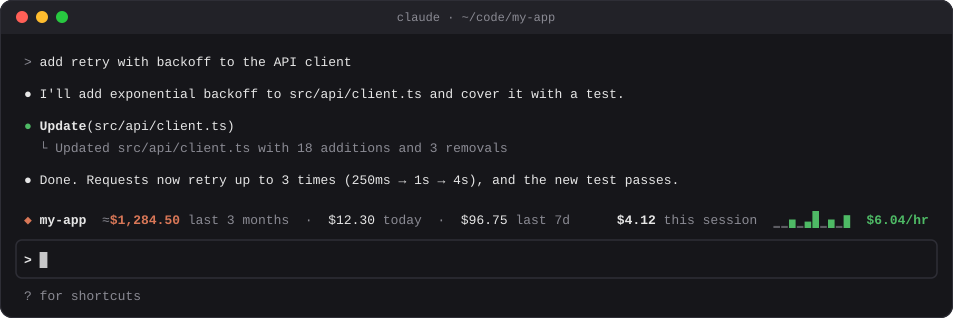
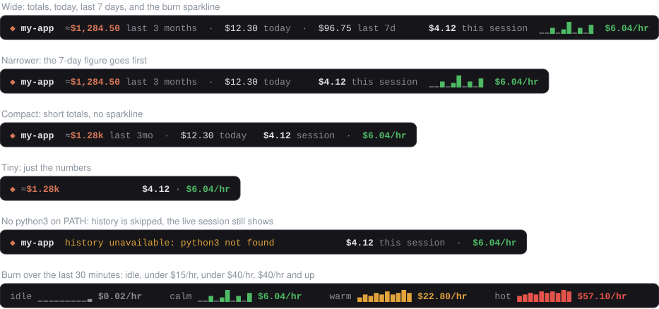
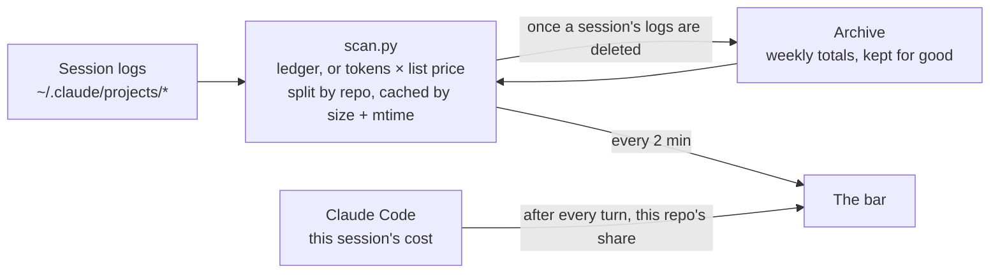

<div align="center">

# repo-spend

**How much have you burned on this repo? How much value are you getting from your plan?**

What your Claude Code sessions cost, per repo, live, right above the prompt.

[](#install)
[](#requirements)
[](#requirements)
[](../../LICENSE)


<p><sub>In the Claude desktop app</sub></p>


<p><sub>In the terminal (<code>claude</code>)</sub></p>

</div>

## Features

- 💰 **A running total per repo.** What every session spent in the repo, its Claude worktrees included, plus today and the last 7 days. A session that edits or works in another repo counts there for that part. It keeps counting after Claude Code clears out old logs, in a weekly archive of dollars and tokens that never rolls off, and after a `/clear`.
- 💳 **Works for API keys and subscriptions.** On an API key it shows the credits you've burned. On Pro or Max it shows what your usage would have cost at API prices, so you can see how much value you're getting from your plan.
- 📈 **Live burn rate.** This session's cost and its pace over the last 30 minutes, with a sparkline that turns amber and then red as the pace climbs.
- 📐 **Fits any width.** At narrower widths it drops the least important details rather than cutting the line off.
- 🧩 **Plays well with other mods.** Bars other mods draw above the prompt stack beneath it instead of being hidden.
- 🔒 **Local only.** It reads the session logs Claude Code already keeps on your machine and sends nothing anywhere.
- ⚡ **Cheap.** Only changed logs are re-read, so a rescan of every repo on the machine takes about 0.1 s.

## Install

Type this at the prompt of a Claude Code terminal session:

```
/plugin install repo-spend --marketplace aseem-upadhyay/qol-mods
```

Answer `y` to add the marketplace and pick the **user** scope. The bar shows up in every session from then on, in the terminal and in the desktop app's Code tab.

Type `/repo-spend` to hide or show it. To remove it:

```bash
claude plugin uninstall repo-spend@qol-mods
```

## Reading the bar



| Part | What it shows |
| --- | --- |
| **◆ repo** | The repo the session runs in. A worktree session counts toward its main checkout |
| **last 3 months** | What every session repo-spend knows about spent on this repo, this one included (see [which repo a session counts toward](#which-repo-a-session-counts-toward)). The label is how far back that reaches, from the oldest session counted, rounded up (see [how far back it goes](#how-far-back-it-goes)). **≈** means some of it is estimated (see [accuracy](#accuracy)) |
| **today · last 7d** | The same total, for today (local time) and for the last 7 days |
| **this session** | The live session's whole cost, the same figure `/cost` shows, subagents included, even when part of it went to another repo. A `/clear` starts it over, as it does in Claude Code; the session you cleared stays in the repo's total |
| **sparkline** | This session's spend in ten 3-minute slices covering the last 30 minutes. A full bar is at least $0.75, so small spends stay small. Drawn as SVG bars on desktop and block characters in the terminal |
| **$/hr** | The pace over those 30 minutes: grey when idle, green under $15/hr, amber under $40/hr, red above |

The history is re-read every 2 minutes, so other sessions open on the same repo show up too. The rate and sparkline move with the clock even while the session is idle.

### Which repo a session counts toward

A session's cost goes where the work was, not just to the repo it started in:

1. **A turn that edits files** goes to the repos it edited. A turn is everything from your prompt to Claude's reply, so the reading and planning before the edit go with it. A turn that edits two repos is split by the number of edits in each. Edit, Write, MultiEdit and NotebookEdit count. Reads, searches and shell commands don't.
2. **Any other message** goes to the repo its working folder was in, so a session that `cd`s into another repo counts there from then on.
3. **Anything else** (a scratch folder, your home folder) stays with the repo the session started in.

So a session started in `app` that fixes a bug in `lib` counts partly toward each, and the two add up to the session. It counts as one session in each. The live session is split the same way: the total, **today** and **last 7d** take only this repo's share, while **this session** stays the whole session. The split follows the logs, so it can trail a turn by up to 2 minutes.

## How it works



The live session's cost comes straight from Claude Code. Past sessions come from `hooks/scan.py`, which reads every session log on the machine, since any session can have worked in this repo. Folders are matched to repos by reading `.git` on disk, so a worktree you've since deleted still counts toward its repo. A session that has Claude Code's own cost record uses it, split between repos in proportion to the estimates. Older sessions are priced from their token counts, and their subagents are counted too.

When Claude Code deletes every log of a session, each repo it worked in gets its share in that repo's archive: one entry per week (Monday to Sunday, local time) with its dollars, sessions and tokens per model. A session that ran across a week boundary is split by when its messages were sent. Every scan sees every repo's logs, so a repo you haven't opened in a month still gets its sessions archived before their logs go.

## Requirements

- Claude Code with mod (hooks module) support
- `python3` 3.9 or newer on your `PATH`. Without it the bar says so and still shows the live session
- macOS or Linux. Windows isn't supported yet

## Accuracy

| Source | Accuracy |
| --- | --- |
| This session | Exact: Claude Code's own figure |
| Past sessions with a Claude Code `cost-state` record | Exact: Claude Code's own ledger |
| Older past sessions without one | Estimated from each message's tokens × list price; the total shows **≈** |

The estimates use the list prices in [`hooks/pricing.py`](hooks/pricing.py) (`PRICES`, dated by `PRICES_UPDATED`). Compared with sessions that do have a ledger, they usually come out a few percent low. Server-side tools such as web search aren't priced.

A model missing from the price table counts as $0. The bar flags it in amber (`+` after the total, and `no price: <model>` when there's room), so you know the total is too low.

Sessions on a subscription show what the same usage would cost at API list prices, not what you paid. That's the point: it's the value you got from your plan.

### How far back it goes

The bar never says "to date". It labels the total with the window it actually covers: the age of the oldest session it counted, rounded **up** to whole days, months or years. So "last 3 months" means every session in the total happened within the last three months. History that starts 2 months and 4 days ago reads "last 3 months", because "last 2 months" would include sessions from before that window.

Claude Code deletes its session logs after 30 days by default (the `cleanupPeriodDays` setting). repo-spend moves each session it has seen into the archive of every repo it worked in once that session's logs go, so from the day you install it the total keeps growing instead of rolling off after a month. That covers every repo on the machine, including ones you don't open.

Archived sessions count toward the total, not toward **today** or **last 7d**, which come from the logs still on disk. With the default 30 days that makes no difference. If you set `cleanupPeriodDays` below 7, those two figures only cover what's left.

Sessions deleted before you installed it can't be counted. To keep more history from now on, raise the setting in `~/.claude/settings.json`, for example `"cleanupPeriodDays": 365`.

## Upgrading from 0.4.0

0.4.0 put a session's whole cost on the repo it started in. 0.5.1 writes new files, in `v2/`, and leaves 0.4.0's alone, so sessions still running 0.4.0 keep working until they restart. The first 0.5.1 scan copies 0.4.0's archives into `v2/`, along with any session the old cache was the only record of, so no history is lost.

- **Totals shift once.** Sessions whose logs are still on disk are counted again by the new rules, so cost moves from the repo a session started in to the repos it worked in. The total across all repos doesn't change.
- **Archived history stays where it was.** The archive keeps weekly totals only, with nothing to split them by.
- **Session counts can go up**, since a session counts in every repo it worked in.
- **The old files** (`<repo>.json` directly in both folders, not in `v2/`) are never touched or read again after the copy. Once every session has restarted on 0.5.1 you can delete them. To go back to 0.4.0, keep them: 0.4.0 reads only those, and they're missing just what 0.5.1 archived since the copy.

## Privacy

- Nothing leaves your machine. There are no network calls.
- It reads only your local session logs in `~/.claude/projects` (or `$CLAUDE_CONFIG_DIR/projects`).
- It reads the logs of every repo, not only the one you're in, because a session started elsewhere can have worked in this one. From each log it keeps costs, token counts, timestamps, working folders and the folders of files Claude edited.
- It writes these files, holding only those figures and folder paths, never your conversations:
  - `~/.cache/claude-repo-spend/v2/folders/<project-folder>.json`, a cache of the logs still on disk, one file per `~/.claude/projects` folder, and `v2/roots.json`, which folder belongs to which repo. The cache is safe to delete; it's rebuilt from the logs. `roots.json` is rebuilt from the `.git` folders on disk, except for folders whose repo you've since deleted: those lose their repo, and their sessions count toward the repo they were started in.
  - `~/.local/share/claude-repo-spend/v2/<repo>.json` (or `$XDG_DATA_HOME/claude-repo-spend/v2`), the archive of sessions whose logs are gone. It's the only record of them: deleting it drops them from the total for good. It's plain JSON, so you can read it, back it up, or sum it yourself.

<details>
<summary><b>Development</b></summary>

From the repository root:

```bash
claude plugin validate plugins/repo-spend
```

```bash
claude plugin test plugins/repo-spend
```

```bash
python3 -m unittest discover -s plugins/repo-spend/tests
```

Run it from a working copy without installing:

```bash
claude --plugin-dir plugins/repo-spend
```

When Anthropic's prices change, edit `PRICES` and `PRICES_UPDATED` in `shared/pricing.py` at the repository root, then copy it into every mod that prices with it:

```bash
python3 scripts/sync-shared.py
```

A new `PRICES_UPDATED` re-reads every log still on disk. Archived weeks keep the prices they were counted at. The tests fail while `hooks/pricing.py` or `hooks/repos.py` (folders to repos, shared with worklog) differs from its shared copy.

Every change ships as a new `version` in `.claude-plugin/plugin.json`. Installed copies are cached by version, and the desktop app's sessions run that cached copy. An edit under the same version never reaches them. After committing a new version:

```bash
claude plugin marketplace update qol-mods && claude plugin update repo-spend@qol-mods
```

New sessions pick it up on their own. A session already open in the desktop app keeps running the version it started with, even after `/reload-plugins`: start a new session to see the change.

The images in `assets/` are drawn by `scripts/repo-spend-assets.py`:

```bash
python3 scripts/repo-spend-assets.py
```

</details>
